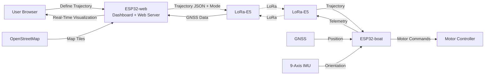

# EMARA


## Overview

The main idea of this project is to develop a cheap and lightweight application for an autonamous boat, with remote trajectory setting over a web application and real-time visualization.

## Detailed Overview



The web application will run over an ESP32 on the ground, which will be called ESP32-web from now on, acting as both softAP and station, which means that it will both create a LAN, as it will connect to an existing AP with internet access, then route this internet to all devices connected to it’s LAN [1]. The reason behind routing the internet is because the ESP32-web doesn’t load pre-installed tiles to the leaflet map, but instead retrieve them from openstreetmap in real time (https://tile.openstreetmap.org/{z}/{x}/{y}.png), thus requiring internet access. Once a trajectory has being defined, the client can press a “send trajectory” button and send a post request to the server containing the JSON object, including the initial position as a waypoint [2].

Once the ESP32-web receives the trajectory, the array of waypoints and the trajectory following mode [3], it blindly [4] starts sending it to the ESP32 on the boat, ESP32-boat, through LoRa point-to-point communication over a LoRa-E5 module powered by a STM32WLE5 (which we will not program, but only communicate with through the Factory AT Firmware via UART, https://wiki.seeedstudio.com/LoRa-E5_STM32WLE5JC_Module/).

Once the trajectory is received by the ESP32-boat, which is also connected via UART to another LoRa-E5 module powered by a STM32WLE5, it first start by downloading the trajectory to the flash memory and freeing the communication channel to start sending GNSS data once again. After the trajectory has being fully read, ESP32-boat must control it’s motors as to follow it, based on it’s current position (GNSS, unknown module yet) and overall orientation (IMU 9-axis, https://wiki.seeedstudio.com/Grove-IMU_9DOF_v2.0/) [5], until a new a trajectory is received.

>[!NOTE]
>1. Currently, both the SSID and password of the ESP32-web network will be printed to the serial monitor, but this behaviour might be removed in future versions.
>2. Wether or not the initial position should be included is currently under discussion, which means that this position might be excluded in future versions.
>3.  See the Trajectory Following Modes sub-section.
>4. There currently is neither any form of trajectory nor json validation, which means that the server “belives” in any text sent through this post request and will blindly forward it to ESP32-boat. This is obviously a huge issue, but solutions will only start to be discussed after 22-dec.
>5. At the early stages of this project, the trajectory following algorithm used will follow the trajectory linearly, meaning that it will not try to balance motor's intensity based on current acceleration in order to counter water's drag. However, we do plan to work on it at the A8 stage: programmed to start dev. at day 29-Nov.

>[!WARNING]
>There currently isn’t any user certification, so anyone connected to the network can access it, meaning that multiple users might define diferent trajectories and the actual trajectory being sent to the boat, or the number of trajectories being actually sent, is undefined. Single user access is currently at discussion, but probably will be neither implemented nor actually seriously considered until 22-december.

### Trajectory Following Modes

- Patrol:
	If ESP32-boat is in Patrol mode, it will go back and forth between the first and the last coordinate.
	
- Hold:
	If ESP32-boat is in Hold mode, it will follow the trajectory until the last coordinate and hold the position.
	
- Move:
	If ESP32-boat is in Move mode, it will follow the trajectory until the last coordinate, but not hold the position, meaning that no reaction will be made against water drag.

## Planning

| Nº da Atividade | Designação              | Descrição                                                                                                                    | Início | Fim    |
| --------------- | ----------------------- | ---------------------------------------------------------------------------------------------------------------------------- | ------ | ------ |
| A1              | Dashboard I             | Implementação de um servidor web no ESP32-web e desenvolvimento do sistema de definição e envio de trajetórias.              | 08-Nov | 14-Nov |
| A2              | Comunicação UART        | Desenvolvimento da comunicação série entre ESP32 e o módulo LoRa-E5.                                                         | 08-Nov | 14-Nov |
| A3              | Comunicação LoRa        | Desenvolvimento da comunicação LoRa entre os dois ESP32 através dos módulos LoRa-E5.                                         | 08-Nov | 21-Nov |
| A4              | Protótipo I             | Teste do sistema de comunicação: testar comunicação entre ESP32-web e ESP32-boat.                                            | 22-Nov | 22-Nov |
| A5              | Navegação e Motores I   | Desenvolvimento de um sistema básico de controlo dos motores com base numa trajetória predefinida (Move e Patrol)            | 22-Nov | 28-Nov |
| A6              | Navegação e Motores II  | Leitura da IMU de 9 eixos e envio da posição GNSS ao ESP32-web + atualização da posição do barco na Dashboard0.              | 22-Nov | 28-Nov |
| A7              | Protótipo II            | Repetir testes da etapa A4 e testar o funcionamento do sistema de navegação desenvolvido na etapa A5.                        | 29-Nov | 29-Nov |
| A8              | Navegação e Motores III | Desenvolvimento de um sistema de adaptação da trajetória com base nos dados obtidos pela IMU e pelo GNSS implementados na etapa A5, e desenvolver modo Hold | 29-Nov | 09-Dec |
| A9              | Dashboard III           | Desenvolvimento de uma nova interface gráfica com foco na usabilidade e na apresentação da informação.                       | 29-Nov | 09-Dec |
| A10             | Produto Final           | Aperfeiçoamento estrutural do protótipo e do seu aspeto visual.                                                              | 10-Dec | 10-Dec |
| A11             | Validação Final         | Repetição da etapa A7 com o sistema aperfeiçoado.                                                                            | 11-Dec | 12-Dec |

## Trajectory

### Trajectory Following Mode

**enum**
```c
{
	Patrol = 1,
	Hold = 2,
	Move = 3
}
```
### JSON format

**Example**
```c
{
    "mode": 1,
    "waypoints": [
        {
            "lat": 51.505,
            "lng": -0.09
        },
        {
            "lat": 51.506,
            "lng": -0.08
        },
        {
            "lat": 51.507,
            "lng": -0.07
        }
    ]
}
```
